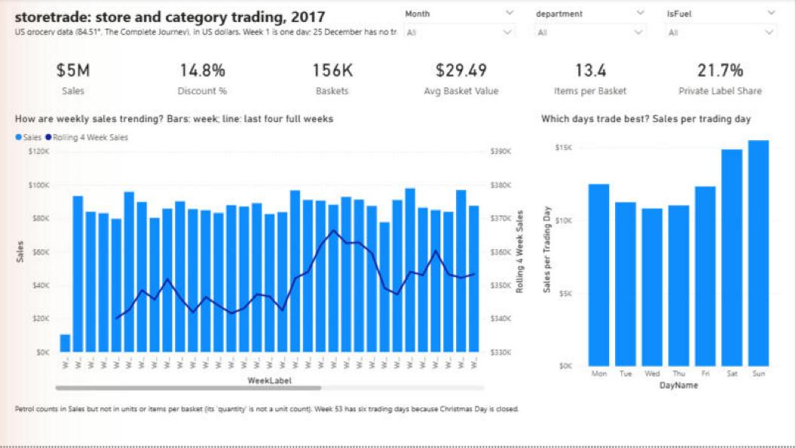
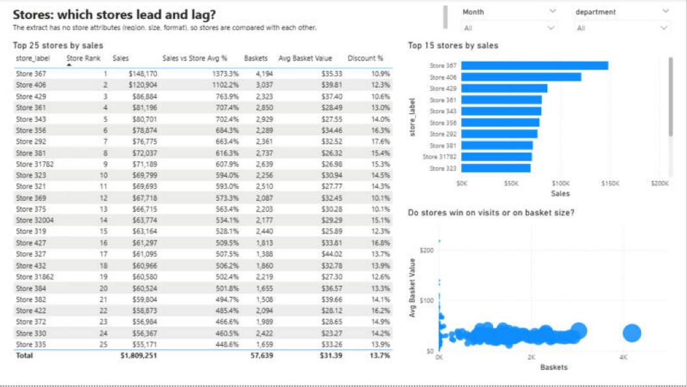
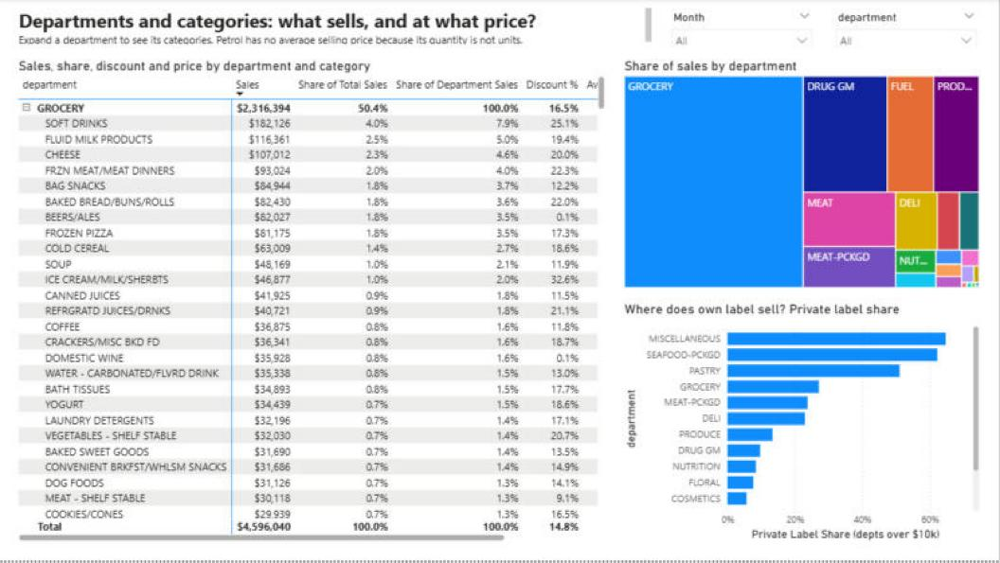
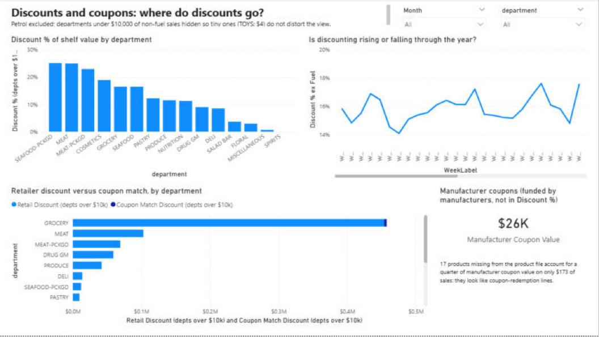
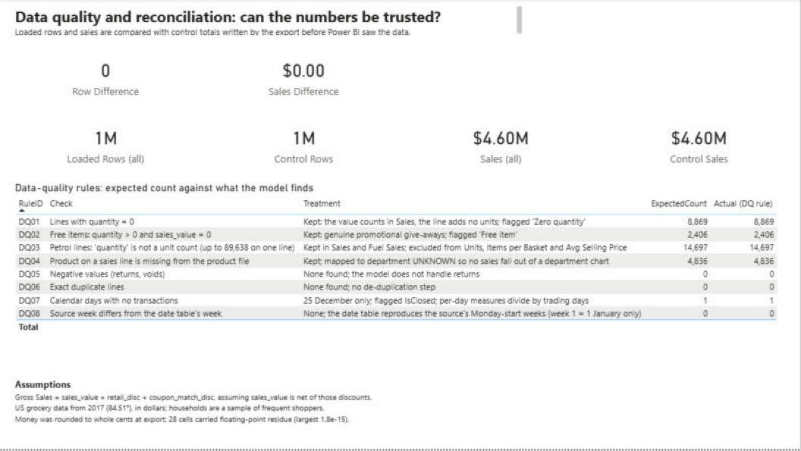

# storetrade: store and category trading report in Power BI

A Power BI report on a year of real grocery transactions: how each store and department trades, how discounts move sales,
and whether the numbers can be trusted. It is built the way a retail reporting team would build one: Power Query to load and
clean, a star-schema model, DAX measures with written definitions, a reconciliation back to the source file, and technical
documentation for the next person.

**Data.** The Complete Journey, from 84.51° (the data arm of a US grocery retailer), via the `completejourney` R package:
1,469,307 transaction lines, 2,469 households, 457 stores, one year (2017), in US dollars. It is
American data from 2017, not UK data and not any UK retailer's. The raw files are not committed (the package page states no
licence; `scripts/export_raw.R` fetches them).

## Status

Built and tested in Power BI Desktop (2.149, November 2025) on Windows, 1 November 2026.

| | |
|---|---|
| Power Query (12 queries in `powerquery/`) | Loads 1,469,307 transaction lines; every step is mirrored in SQL by `scripts/reference.py` |
| DAX (`powerbi/measures.dax`, 45 measures) | Loaded into the model from the template |
| Tests | `powerbi/tests.dax` in Desktop's DAX query view: **44 of 44 checks PASS** against numbers computed independently in DuckDB, and the 3 blank-by-design checks are TRUE (`docs/img/tests_pass_44.jpg`, `docs/img/tests_blank_checks.jpg`) |
| Reconciliation | Rows and sales match `control_totals.csv` exactly (difference 0 and $0.00) |
| Report | 5 pages, 42 visuals: `storetrade.pbix` (data loaded) and `dist/storetrade.pbit` (template, no data) |

**Bug found in Desktop and fixed.** The first build ranked every store 1 and showed 0.0% against the store average:
`ALLSELECTED(Dim_Store[store_label])` misbehaves because `store_label` is sorted by `store_no`, so the sort column
stays in the filter context. The measures now use `ALLSELECTED(Dim_Store)` and the whole-table average, and return blank on totals.

Known cosmetic issues: the weekly charts scroll sideways (53 week labels); the data-quality cards show rounded
values (1M, $4.60M), and the exact figures are in the tests.

## Report pages

## What the data says (reference run in DuckDB; Power BI returns the same numbers)

| | |
|---|---|
| Sales | $4,596,039.58 on 155,848 baskets: $29.49 per basket |
| Discounts | $796,193.29 = 14.8% of the $5,392,232.87 shelf value (retail discount and retailer coupon match; manufacturer coupons, $26,359.90, are separate) |
| Petrol | $384,044.07 (8.4% of sales) on 14,697 lines whose "quantity" is not a unit count, so units and basket size exclude it |
| Private label | 21.7% of non-fuel sales |
| Data quality | 8,869 zero-quantity lines, 2,406 free items, 4,836 lines for products missing from the product file, no returns, no duplicates, 25 December absent |

## Repository

| Path | What |
|---|---|
| `scripts/export_raw.R` | Exports the data to CSV and writes `control_totals.csv` from the source object |
| `powerquery/*.m` | One file per query, in load order (see `docs/REFRESH.md`) |
| `powerbi/measures.dax` | Every measure, with comments |
| `powerbi/tests.dax` | Expected-versus-actual checks, generated from the reference run |
| `powerbi/REPORT_SPEC.md` | The five report pages, visual by visual |
| `scripts/reference.py` | Independent SQL mirror of every rule and measure; writes `outputs/reference_values.*` |
| `docs/BUILD_GUIDE.md` | Step-by-step build in Power BI Desktop, with checkpoints and fixes for common errors |
| `docs/` | Data model, data flow, business rules, data dictionary, data quality, refresh process |
| `tests/` | pytest: reference identities, and consistency between the M, DAX and test files |

## Honest limits

- US data, 2017, dollars. No store attributes exist (no region, size or format), so stores are compared with each other, not by region.
- `Gross Sales = sales_value + retail_disc + coupon_match_disc` assumes `sales_value` is net of those two discounts. The data
  supports it (shelf prices are more stable this way than with the alternative) but the package page does not define the
  fields, so it is an assumption, stated in `docs/BUSINESS_RULES.md`.
- Households are a sample of frequent shoppers, so household measures describe loyal customers, not all customers.
- Week 1 is one day (Sunday 1 January) and 25 December has no transactions: week-on-week skips the first and per-day
  measures use trading days.
