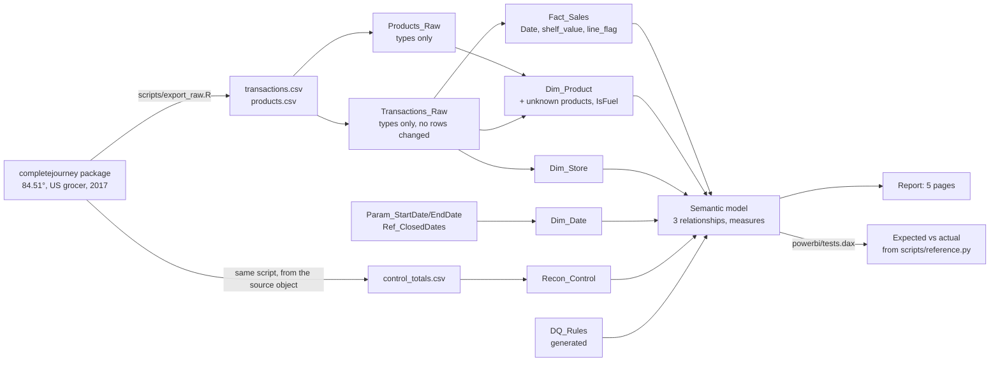

# Data flow

| Step | What happens | Rows in → out | Where |
|---|---|---|---|
| Export | Source object written to CSV; control totals taken from the source | 1,469,307 → 1,469,307 | `scripts/export_raw.R` |
| Transactions_Raw | Read, text keys, money as fixed decimal, timestamp parsed. Nothing removed | 1,469,307 → 1,469,307 | `powerquery/Transactions_Raw.m` |
| Fact_Sales | Adds Date, shelf_value, line_flag; renames week to source_week | 1,469,307 → 1,469,307 | `powerquery/Fact_Sales.m` |
| Products_Raw | Read products.csv, set types (staging, not loaded) | 92,331 → 92,331 | `powerquery/Products_Raw.m` |
| Dim_Product | Products_Raw + products on sales lines but not in the file; IsFuel. Reads no file itself (avoids the Formula.Firewall) | 92,331 + 17 | `powerquery/Dim_Product.m` |
| Dim_Store | Distinct store ids | 457 | `powerquery/Dim_Store.m` |
| Dim_Date | One row per day; Monday-start weeks matching the source; partial and closed flags | 365 | `powerquery/Dim_Date.m` |
| Reconcile | Model rows and sales compared with `control_totals.csv` | difference must be 0 | Reconciliation page; `tests.dax` |

No line is deleted anywhere in the flow. Issues are flagged or handled in a dimension, so the report always reconciles to the
source (rows, sales value) and every treatment is a visible rule (`docs/BUSINESS_RULES.md`).
