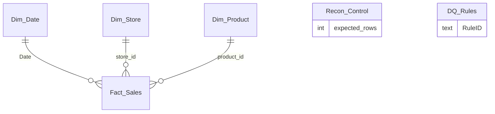

# Data model (technical specification)

Import mode, one fact table and three dimensions (a star). Household is not a dimension: the extract has an id and nothing
else about households, so `household_id` stays on the fact and is counted with DISTINCTCOUNT.

| Table | Grain | Rows | Source |
|---|---|---|---|
| Fact_Sales | one transaction line | 1,469,307 | `transactions.csv` |
| Dim_Product | one product | 92,348 (92,331 from the file + 17 unknown) | `products.csv` + keys found on sales lines |
| Dim_Store | one store | 457 | distinct `store_id` on sales lines |
| Dim_Date | one calendar day | 365 | generated from `Param_StartDate` to `Param_EndDate` |
| Recon_Control | one row | 1 | `control_totals.csv` (written before Power BI) |
| DQ_Rules | one rule | 8 | generated by `scripts/reference.py` |
| _Measures | none | 0 | holds the measures |

## Relationships

| From (many) | To (one) | Cardinality | Filter direction | Active |
|---|---|---|---|---|
| Fact_Sales[product_id] | Dim_Product[product_id] | many to one | single | yes |
| Fact_Sales[store_id] | Dim_Store[store_id] | many to one | single | yes |
| Fact_Sales[Date] | Dim_Date[Date] | many to one | single | yes |

`Recon_Control` and `DQ_Rules` are disconnected on purpose: they are reference tables, not filters. Referential integrity was
checked in the reference run: orphan product keys 0, store keys 0, date keys 0.

## Model settings

- Mark `Dim_Date` as the date table on `[Date]`.
- Sort: `Dim_Store[store_label]` by `store_no`; `Dim_Date[Month]` by `MonthNo`; `Dim_Date[WeekLabel]` by `WeekNo`; `Dim_Date[DayName]` by `DayNo`.
- Hide: every key and flag column on `Fact_Sales`, `store_id`, `store_no`, `WeekNo`, `MonthNo`, `DayNo`, and the `_Measures` placeholder column.
- Summarization "Don't summarize" on all columns (measures do the aggregating); `Fact_Sales[sales_value]` and the other money columns are Fixed decimal.
- Display folders for measures: Sales and discounts; Baskets and units; Mix and ranking; Time; Data quality; Reconciliation.
- Row-level security: none (no personal data; households are numeric ids; no names, addresses or card numbers exist in the extract).

## Performance notes

- `Transactions_Raw` is read three times (fact, product keys, store keys), so the first load reads the 110 MB CSV three times (a minute or two).
- `Source Week Mismatch Lines` scans every line: use it on the Data Quality page only.
- `Fact_Sales[transaction_timestamp]` is kept for an hour-of-day analysis; remove it to shrink the model if you do not use it.
